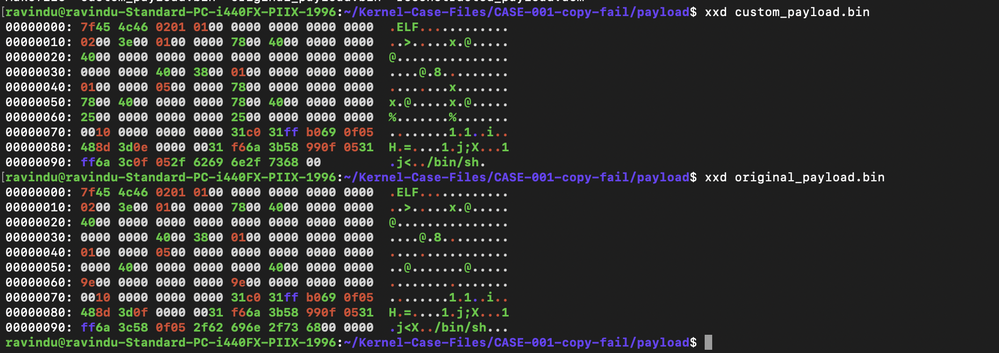
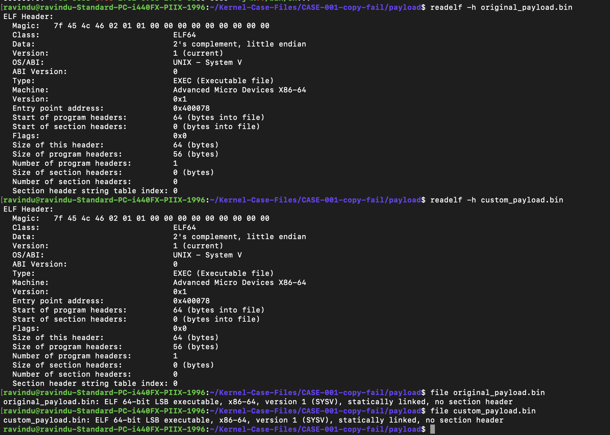
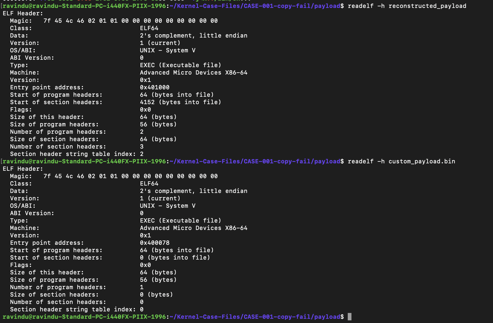

# Build a minimal payload

- CLAIM
    - Build a minimal payload.

- INTERPRETATION
    - Original payload has these sections only. So our goal is build exact same layout like original.
        1. ELF header
        2. `1` program header
        3. `.text` section

- TEST
    - manual method for use these tools
        - dd (extract= elf header, program header, .text section)
        - objcopy(dump section = .text)
        - hexedit(edit elf header, otherwise elf file not run.)

    - automate
        - run scripts/custom_elf.py

- RESULT

**Raw byte comparison**

**ELF header comparison**

**Before and after reconstructed payload**

- STATUS
    - `[CONFIRMED]`