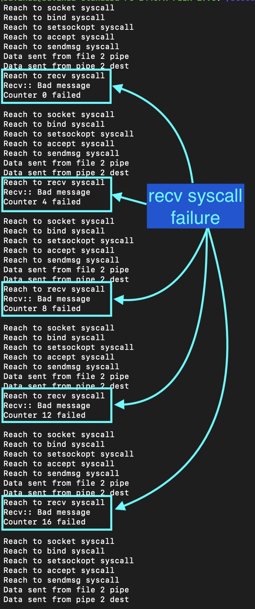
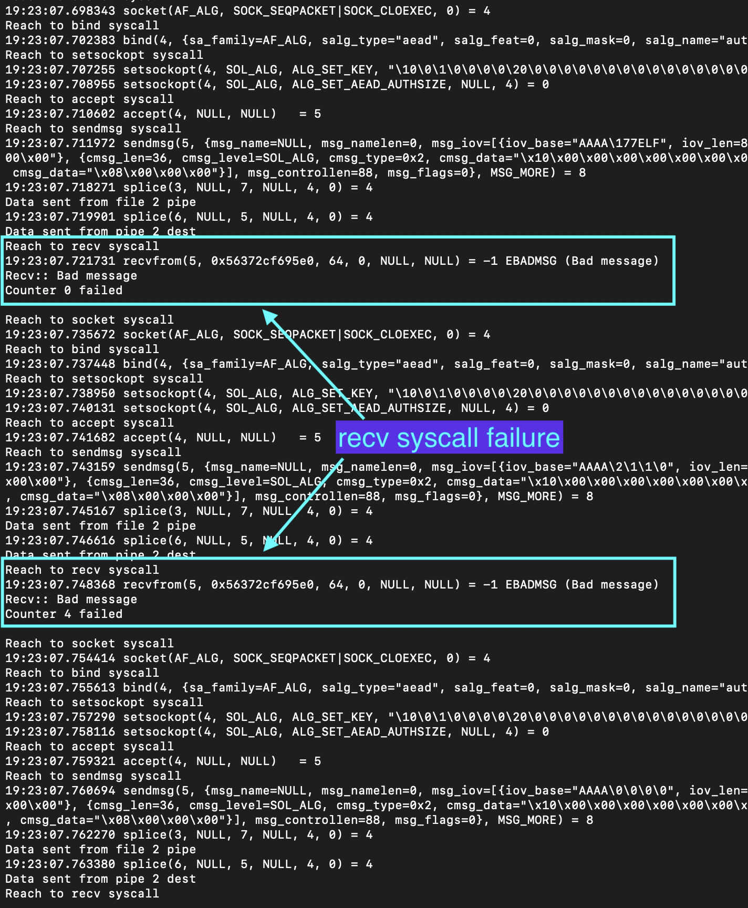

# recv syscall failure

- CLAIM
    - `recv` syscall failed all the time.

- TEST
    - run /scripts/reproducer/exploit
    - settings = enable debug info

- RESULT

**recv syscall failure in debug message perspective**

**recv syscall failure in strace**

- TODO
    - Find a reason for the recv syscall failure.

- STATUS
    - `[CONFIRMED]`