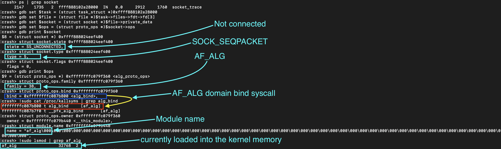

# af_alg Linux kernel module involvement

- CLAIM
    - When calling the socket syscall with AF_ALG, it loads the af_alg kernel module.

- TEST
    - One terminal: run sys_passpayload/socket_caller
    - Second terminal, use the crash utility to analyse that socket.

- RESULT

- INTERPRETATION
    - When a user calls the af_alg domain-based syscalls, the af_alg module is auto-loaded into the kernel memory.

- STATUS
    - `[CONFIRMED]`