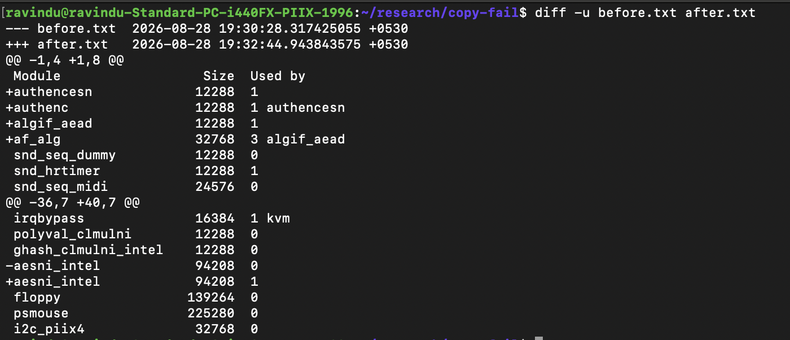

# A few more modules enter to the party.

- CLAIM
    - When we call socket () and bind (), and pass data, a few more modules are loaded.

- TEST
    - run scripts/sys_passpayload/bind_caller
    - And compare before and after
        - use `lsmod` command there.

- RESULT

- OBSERVATION
    - newly loaded modules
        1. authencesn
        2. authenc
        3. algif_aead
        4. af_alg => we saw this before
        5. aesni_intel

- STATUS
    - `[CONFIRMED]`
