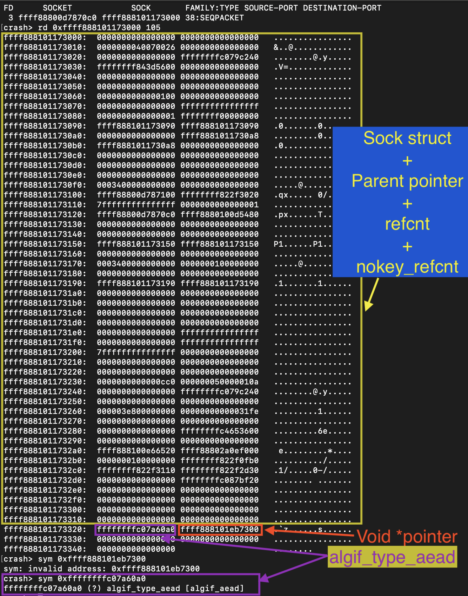

# Jump to algif_aead module

- CLAIM
    - Found a link to where the algif_aead module connects to the exploit.

- TEST
    - Follow the process via the `crash` utility.

- OBSERVATION
    - It link like this(Internal kernel structures).
        1. process task struct
        2. task_struct => files structure(files_struct)
        3. files_struct => fdtable struct
        4. fdtable => file struct (fd[fd number])
        5. file struct => private_data(pointer type `void *`)
        6. private_data => socket struct(VFS layer){not always socket but in this case private data has socket structure}
        7. socket structure => sock/alg_sock struct(network subsystem, in this case its alg_sock)
        8. alg_sock => This is the struct we wanted.

    - Extracting alg_sock
        - It defined like this(in kernel 6.17)
```c
struct alg_sock {
	/* struct sock must be the first member of struct alg_sock */
	struct sock sk;

	struct sock *parent;

	atomic_t refcnt;
	atomic_t nokey_refcnt;

	const struct af_alg_type *type;
	void *private;
};
```
- 
    - 
        - We can't display alg_sock because it's a kernel internal structure and not compiled into vmlinux. Therefore, the crash utility does not identify alg_sock.

        - Manually counting the bytes for `af_alg_type` struct.(we wanted struct => af_alg_type)
            - `struct sock sk` => 784 bytes(according to kernel 6.17)
            - `struct sock *parent` => 8 bytes(just pointer)
            - `atomic_t refcnt` => 4 bytes
            - `atomic_t nokey_refcnt` => 4 bytes
            - `const struct af_alg_type *type;` => 8 bytes(just pointer)
            - `void *private` => 8 bytes(just pointer)

        - Totally we need to skip 800 bytes for reach `const struct af_alg_type *type;` pointer.(Keep more room; otherwise, this will fail all the time (I mean byte count).)

- RESULT


- STATUS
    - `[CONFIRMED]`