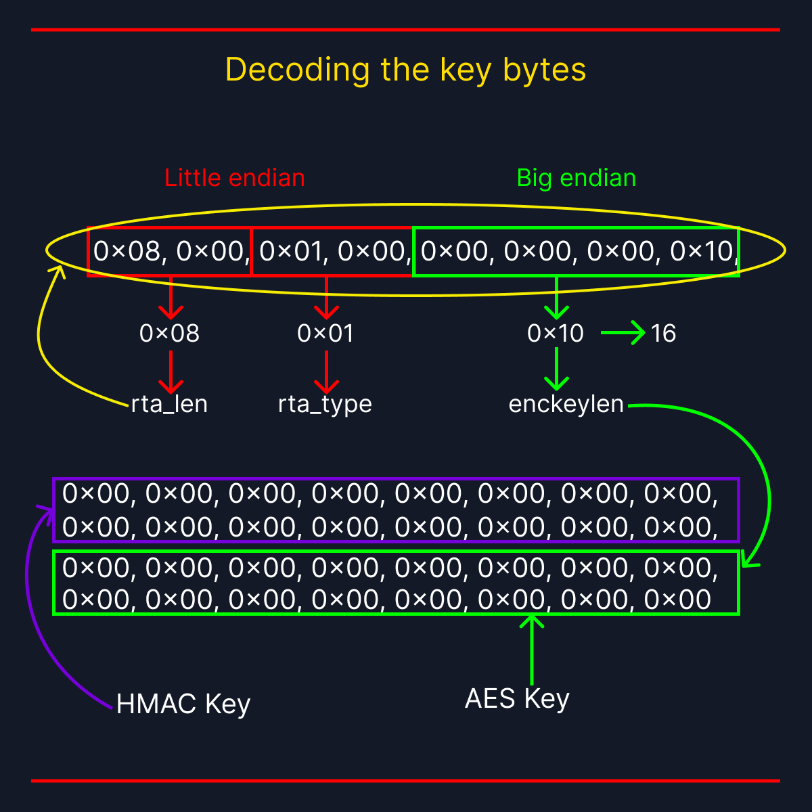

# Decoding the key bytes

- CLAIM
    - It's rtattr header + enckeylen bytes; that's why we got the `-EINVAL` error code when assigning random bytes.

- INTERPRETATION



- 
    - In the kernel, rtattr is defined like this in `include/uapi/linux/rtnetlink.h`
```c
/* 
   Generic structure for encapsulation of optional route information.
   It is reminiscent of sockaddr, but with sa_family replaced
   with attribute type.
 */

struct rtattr {
	unsigned short	rta_len;
	unsigned short	rta_type;
};
```
- 
    - And enckeylen defined like this in `include/crypto/authenc.h`
```c
struct crypto_authenc_key_param {
	__be32 enckeylen;
};
```

- FAILURES
    - Before, we failed. Because we didn't understand the rtattr header and enckeylen.

- STATUS
    - `[CONFIRM]`