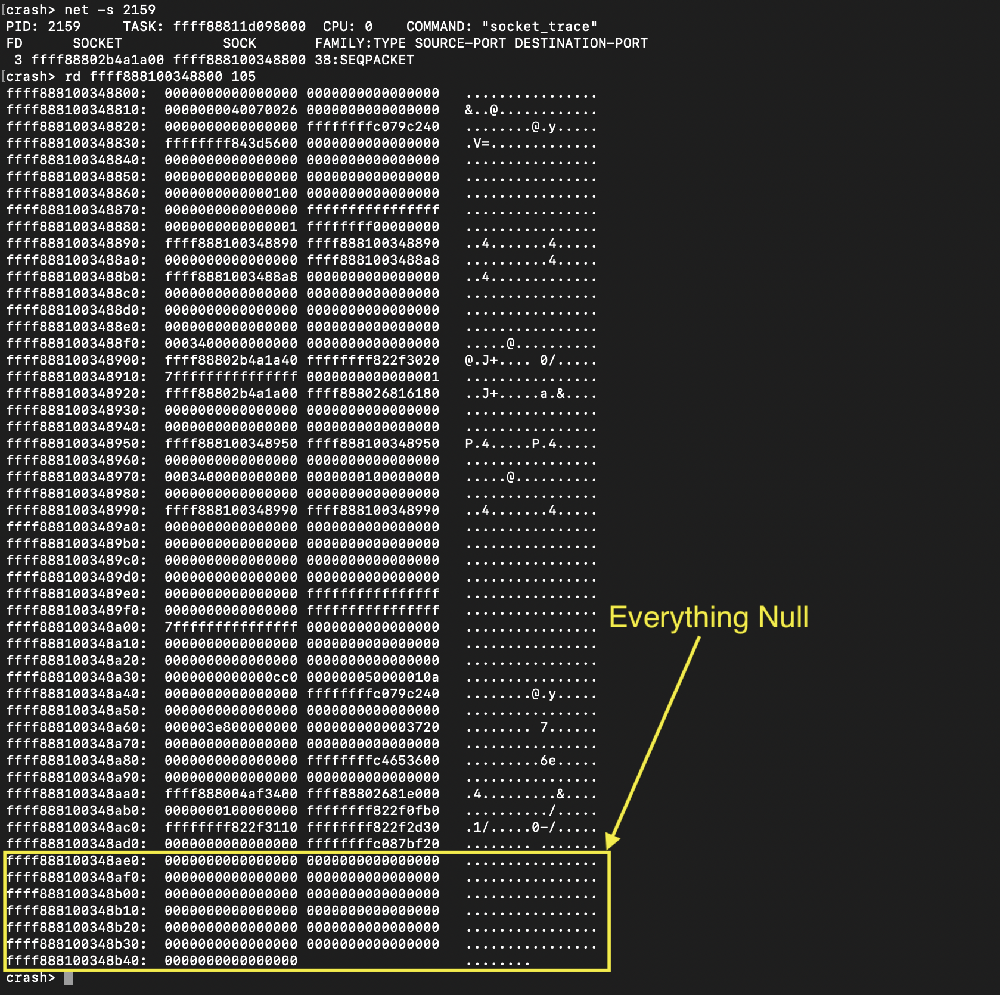
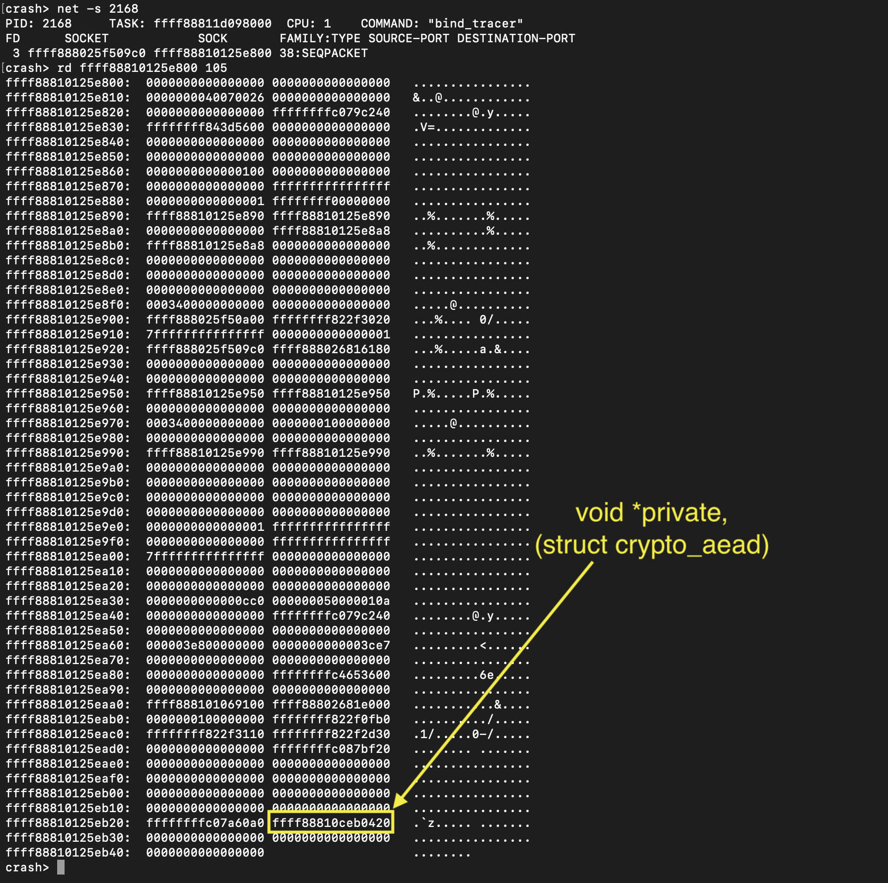

# crypto_aead structure involvement

- CLAIM
    - When we call the bind syscall with related data, we can clearly see the crypto_aead struct's involvement within the alg_sock structure.

- EVIDENCE

**Before bind syscall**

**After bind syscall**

- INTERPRETATION
    - When we call the bind syscall with proper data, it loads the necessary module, creates objects, and link back it to running process.

    - To confidently say it's crypto_aead, you need to follow the bind syscall path -> af_alg->algif_aead->internal crypto APIs, because this changes when the user pass algorithm changes.

- TEST
    - run scripts/sys_passpayload/socket_caller
    - run scripts/sys_passpayload/bind_caller
    - And above each process analyse with `crash` utility.

- STATUS
    - `[CONFIRM]`