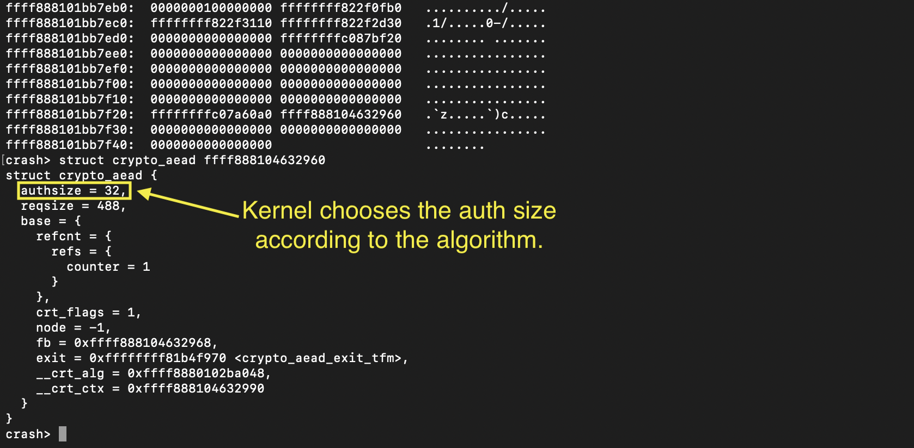

# Set maximum authsize according to the algorithm

- CLAIM
    - Until replce it via user-sent authentication tag size, Kernel sets the maximum authentication tag size according to the algorithm.

- EVIDENCE

- INTERPRETATION
    - We never pass the authentication tag size via the bind syscall
    - Kernel chooses to assign the maximum authentication tag size according to the algorithm
    - This value is replaced when the user sends the authentication tag size.
    
- TODO
    - Show this value being replaced. It happen 2nd setsockopt sends data after (in our full scripts)

- STATUS
    - `[CONFIRM]`