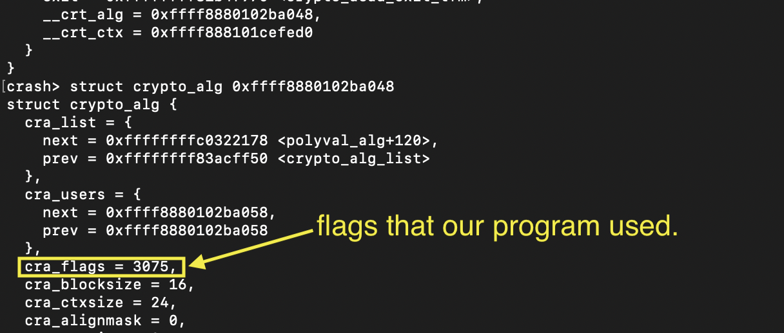

# Decoding the cra_flags

- CLAIM
    - Understanding the cra_flags that our program used.

- EVIDENCE

- INTERPRETATION
    - flags = 3075
        - binary = 110000000011b
        - 0x3 = CRYPTO_ALG_TYPE_AEAD (1 + 2 take as flag 3, rather than 2 flags)
        - 0x400 = CRYPTO_ALG_TESTED
        - 0x800 = CRYPTO_ALG_INSTANCE
    - defined in `include/linux/crypto.h`

- STATUS
    - `[CONFIRM]`