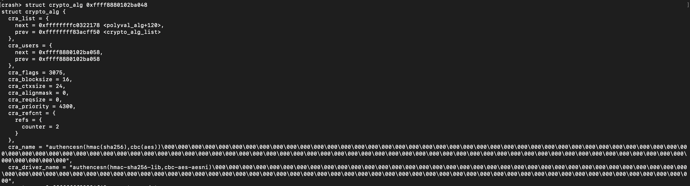

# Set cra_name and cra_driver_name according to salg_name

- CLAIM
    - User sends the socket algorithm name, Kernel sets the cryptographic name and cryptographic driver names.

- EVIDENCE

- INTERPRETATION
    - Set the cryptographic name as we sent salg_name.
    - Set the cryptographic driver names to execute our code.

- STATUS
    - `[INFERRED]`