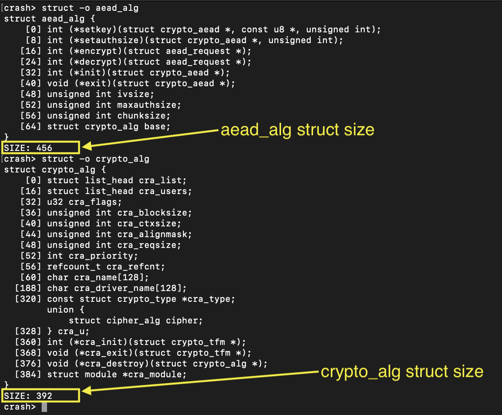
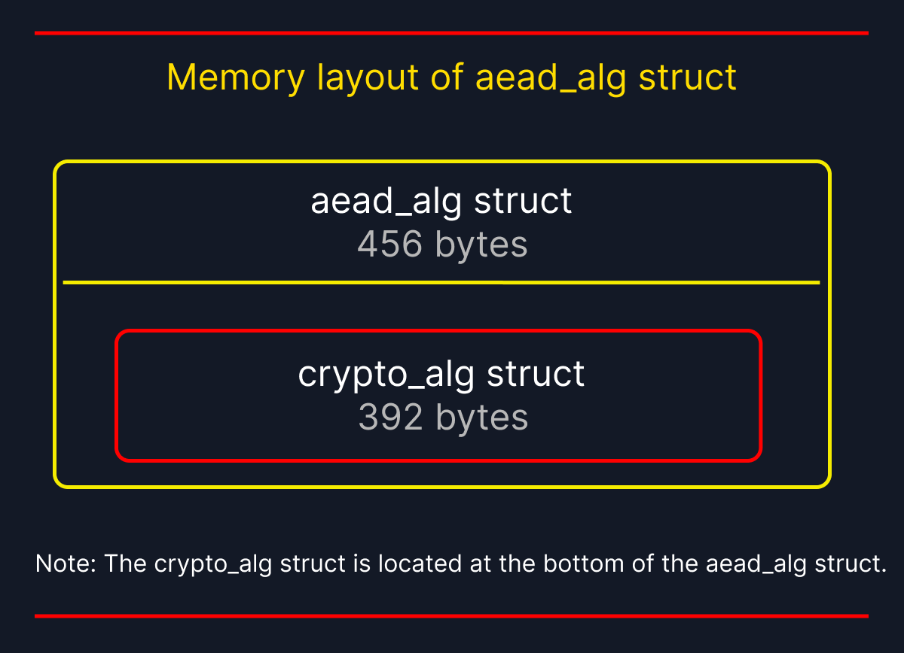
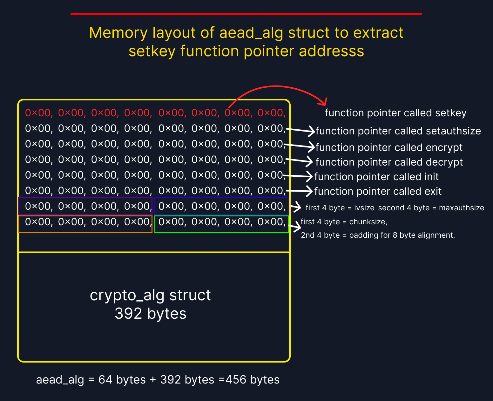
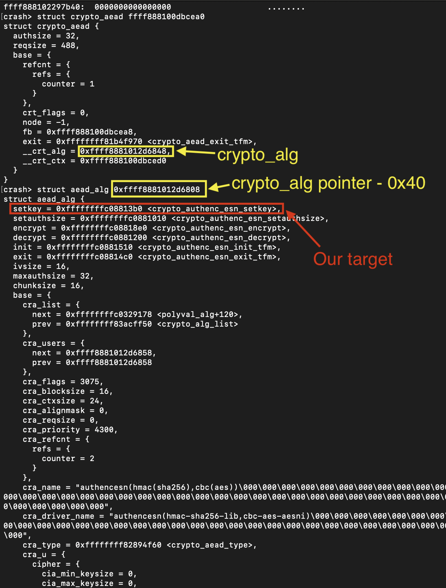

# Manual pointer subtraction to jump aead_alg structure

- CLAIM
    - We struggled to find the setkey function address because the code used container_of macros. So, in our case, we should use pointer subtraction to do that.

- TEST
    - run scripts/sys_passpayload/setkey
    - Analyse crypto_aead & aead_alg structs via crash utility

- EVIDENCE
    - **structs sizes**

- OBSERVATIONS
    - **Identified memory layout**

- - **Bytes view of aead_alg for extract setkey function pointer address**

- RESULT
    - **Jump to aead_alg struct**

- INTERPRETATION
    - STEPS
        1. get a pointer to crypto_alg struct
        2. substract 64 bytes from it.
        3. You get pointer to aead_alg.

- STATUS
    - `[CONFIRM]`