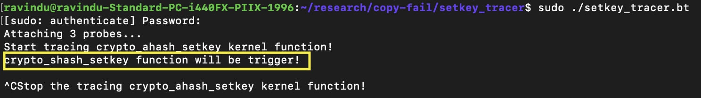

# Check the setkey func use shash or not

- CLAIM
    - crypto_authenc_esn_setkey called crypto_ahash_setkey to set the key for the cipher handle. But the issue happens there. Because we don't know whether it enables using_shash. So if it's enabled, it goes to the crypto_shash_setkey path. But if it isn't, it goes to another path. So this is the moment to properly check that.

- EVIDENCE

```c
int crypto_ahash_setkey(struct crypto_ahash *tfm, const u8 *key,
			unsigned int keylen)
{
	if (likely(tfm->using_shash)) {
		struct crypto_shash *shash = ahash_to_shash(tfm);
		int err;

		err = crypto_shash_setkey(shash, key, keylen);
		if (unlikely(err)) {
			crypto_ahash_set_flags(tfm,
					       crypto_shash_get_flags(shash) &
					       CRYPTO_TFM_NEED_KEY);
			return err;
		}
	} else {
		struct ahash_alg *alg = crypto_ahash_alg(tfm);
		int err;

		err = alg->setkey(tfm, key, keylen);
		if (!err && crypto_ahash_need_fallback(tfm))
			err = crypto_ahash_setkey(crypto_ahash_fb(tfm),
						  key, keylen);
		if (unlikely(err)) {
			ahash_set_needkey(tfm, alg);
			return err;
		}
	}
	crypto_ahash_clear_flags(tfm, CRYPTO_TFM_NEED_KEY);
	return 0;
}
EXPORT_SYMBOL_GPL(crypto_ahash_setkey);
```

- TEST
    - run scripts/using_shash-tracer.bt
    - run scripts/sys_passpayload/setkey

- RESULT


- INTERPRETATION
    - It enables `using_shash`.
    - And it will go to the `crypto_shash_setkey` path.

- STATUS
    - `[CONFIRM]`