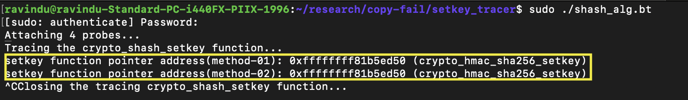

# Extracting the setkey function pointer from shash_alg

- CLAIM
    - Manually extracting the setkey function pointer. And get shash_alg through crypto_shash.

- TEST
    - run scripts/shash_alg.bt
    - run scripts/sys_passpayload/setkey

- RESULT

- OBSERVATION
    - shash_alg has setkey function pointer points to `crypto_hmac_sha256_setkey`

- STATUS
    - `[CONFIRM]`

