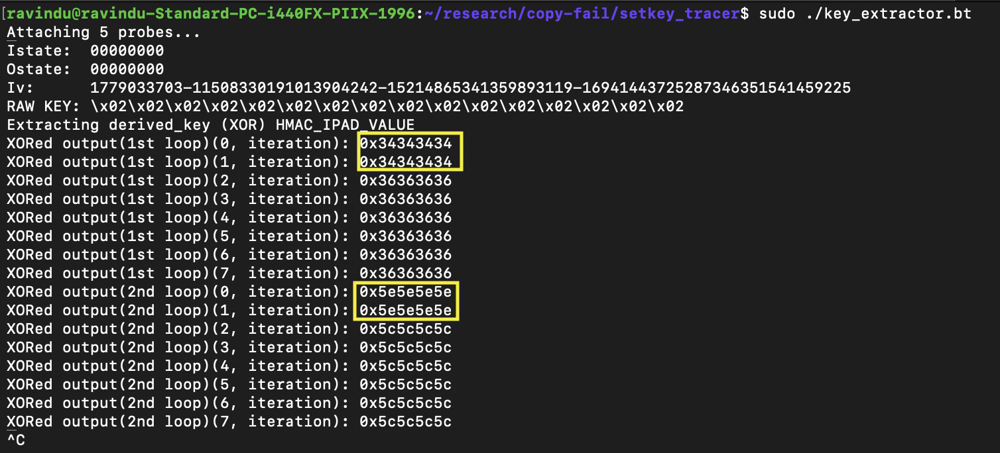

# Analyse of hmac_sha256_preparekey function.

- CLAIM
    - This is the last function where we saw our raw HMAC key; after this, it became an XORed key.

- TEST
    - run scripts/sys_passpayload/key_prepare.bt
    - run scripts/sys_passpayload/setkey

- RESULT

- INTERPRETATION
    - This is the last function where we saw our raw HMAC key; after this, it became an XORed key. After this function, it wiped out the buffer.

- TODO
    - NO idea about `iv`, so need to find about it.
    - Need to trace sha256_blocks.

- STATUS
    - `[CONFIRM]`