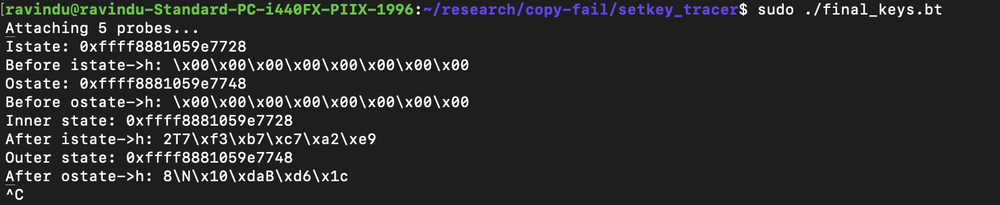

# Extracting the inner and outer states

- CLAIM
    - After this, there wasn't an HMAC key anymore.
    - The raw key was converted to 2 states called inner and outer.

- TEST
    - run scripts/sys_passpayload/block_state_extractor
    - run scripts/sys_passpayload/setkey

- RESULT

- INTERPRETATION
    - we provided raw HMAC key and it does these two thing
        1. Inner state
            - XOR ipad (0x36)
            - SHA-256 compression (sha256_block_generic function)
            - ISTATE (inner state)

        2. Outer state
            - XOR opad (0x5c)
            - SHA-256 compression (sha256_block_generic function)
            - OSTATE (outer state)

- STATUS
    - `[CONFIRM]`