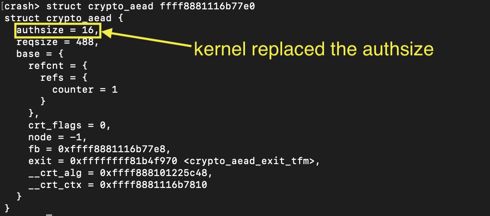

# Replace the authsize

- CLAIM
    - Kernel replaced the authsize.

- TEST
    - run /scripts/sys_passpayload/authsize

- RESULT

- INTERPRETATION
    - First, the kernel chooses to assign the maximum authentication tag size according to the algorithm.

    - Next, when the user sends the authsize, the kernel replaces the previously set authsize.

- STATUS
    - `[CONFIRM]`