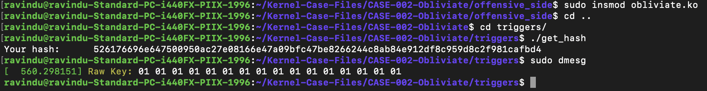

# Extracting the HMAC key

- CLAIM
    - Extracting the user-passed HMAC keys from kernel memory.

- TEST
    - open offensive_side/config/obliviate_config.h
    - enable this flag
        - REVEAL_THE_HMAC_KEY
    - load the kernel module
    - run triggers/get_hash

- RESULT
**HMAC key**

- INTERPRETATION
    - To achieve this goal, we follow these steps.
        1. hooked the __hmac_sha256_preparekey function via kprobe.
        2. Extract the HMAC key via the 3rd and 4th function arguments.

    - For more details, study the code.
        - [Extract hmac key](offensive_side/helpers/hmac_helpers.h)

- STATUS
    - `[CONFIRM]`