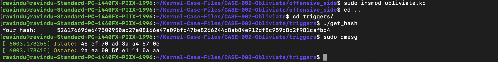

# Expose the HMAC states

- CLAIM
    - Expose the HMAC inner and outer states.

- TEST
    - open offensive_side/config/obliviate_config.h
    - enable this flag
        - REVEAL_THE_HMAC_STATES
    - load the kernel module
    - run triggers/get_hash

- RESULT
**HMAC states**

- INTERPRETATION
    - This is a little bit of a devastating method.

    - **Steps**
        - I replicated the __hmac_sha256_preparekey function logic inside my prehandler to extract the states.
        - And later, clear the data I polluted.

    - I adopted this method because of the complexity involved in the alternative methods.

- STATUS
    - `[CONFIRM]`