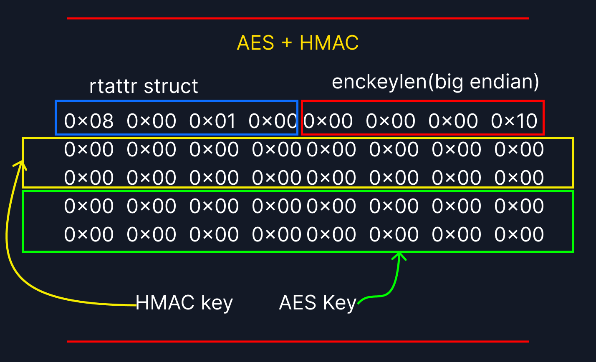

# Understanding the AES and HMAC key memory layout

- CLAIM
    - Understanding the AES and HMAC key memory layout.
    - (according to our authencesn example).

- INTERPRETATION



- CODE

```c
/* 
   Generic structure for encapsulation of optional route information.
   It is reminiscent of sockaddr, but with sa_family replaced
   with attribute type.
 */

struct rtattr {
	unsigned short	rta_len;
	unsigned short	rta_type;
};

struct crypto_authenc_key_param {
	__be32 enckeylen;
};

```

- - Later we came to extract the AES key from a completely different function. You need the above details.

- SPECIAL NOTE
    - `In this research, I focused specifically on the memory layouts of HMAC and AES keys. While other algorithms may use HMAC, they fall outside the scope of this work. Consequently, this study centers heavily on the AES–HMAC combination. It would be inaccurate to generalize these findings to all memory layouts—much like analyzing a single individual and assuming their traits apply to the entire global population.`

- STATUS
    - `[CONFIRM]`
