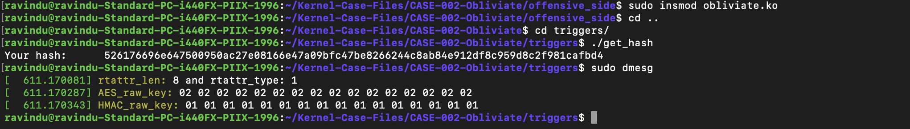

# Extracting the AES key

- CLAIM
    - Extracting the AES key from a completely different function.

- TEST
    - open offensive_side/config/obliviate_config.h
    - enable this flag
        - REVEAL_THE_AES_KEY
    - load the kernel module
    - run triggers/get_hash

- RESULT
**AES key**

- INTERPRETATION
    - The __hmac_sha256_preparekey function provided us with a pointer to the starting position of the HMAC key.
    - if we go back 8 bytes from that point. We can get the header(rtattr + enckeylen).
    - Then extract enckeylen because that's the length of the AES key.
    - Now the process is simple, follow this flow for that
        - AES key starting point = HMAC key + HMAC key size
        - AES len = enckeylen.

    - More info
        - [memory layout](06_aes_and_hmac_key_memory_layout.md)
        - [aes key extraction](offensive_side/helpers/aes_helpers.h)

- STATUS
    - `[CONFIRM]`