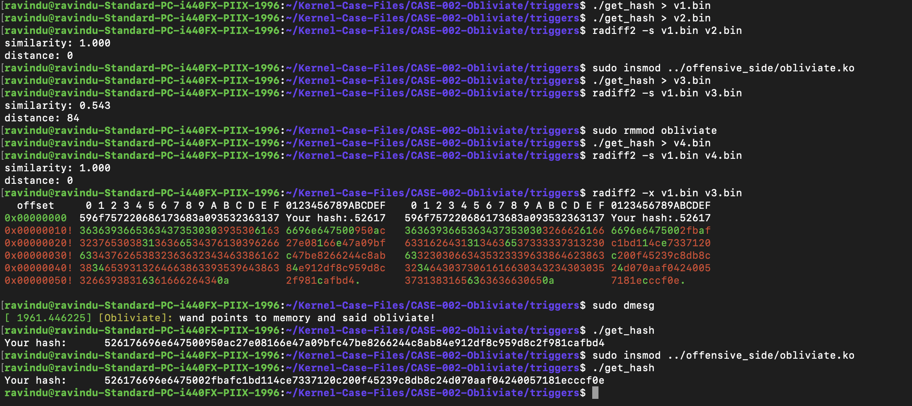

# Changing the AES key

- CLAIM
    - Change the aes key inside the kernel memory.

- TEST
    - open offensive_side/config/obliviate_config.h
    - enable this flag
        - FREE_KERNEL_PANIC
    - load the kernel module
    - run triggers/get_hash
    - unload the kernel module
    - run triggers/get_hash

- RESULT

- OBSERVATION
    - Even with the same program, the same key, and the same message, we can clearly see that the hash value changed completely after loading the module.

- INTERPRETATION
    - to change the hmac key we follow these steps
        1. The AES key is a byte array.
        2. We replace that byte array with our byte array(our key).

    - Special things.
        - We avoid memcpy there. 
        - Because there wasn't fault protection, 
        - it could cause a kernel panic if something went wrong.
        - So we used the copy_to_kernel_nofault api to more safety. 

    - But with some tricks. So if you need to understand that, read this file.
        - [aes_helpers](offensive_side/helpers/aes_helpers.h)

- STATUS
    - `[CONFIRM]`