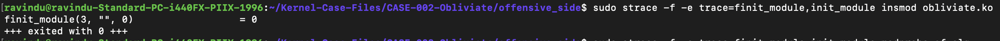
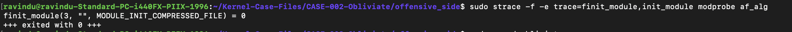
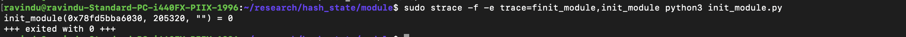

# Linux kernel module loading mechanisms

- CLAIM
    - There are two syscalls we can use for loading a kernel module(except directly putting it into memory)
        1. finit_module (SYSCALL NUMBER = 313)
        2. init_module (SYSCALL NUMBER = 175)

- TEST
    - trace the insmod, modprobe or your custom script.

- RESULT

**Insmod utility**

**Modprobe utility**

**My custom script**

- STATUS
    - `[CONFIRM]`