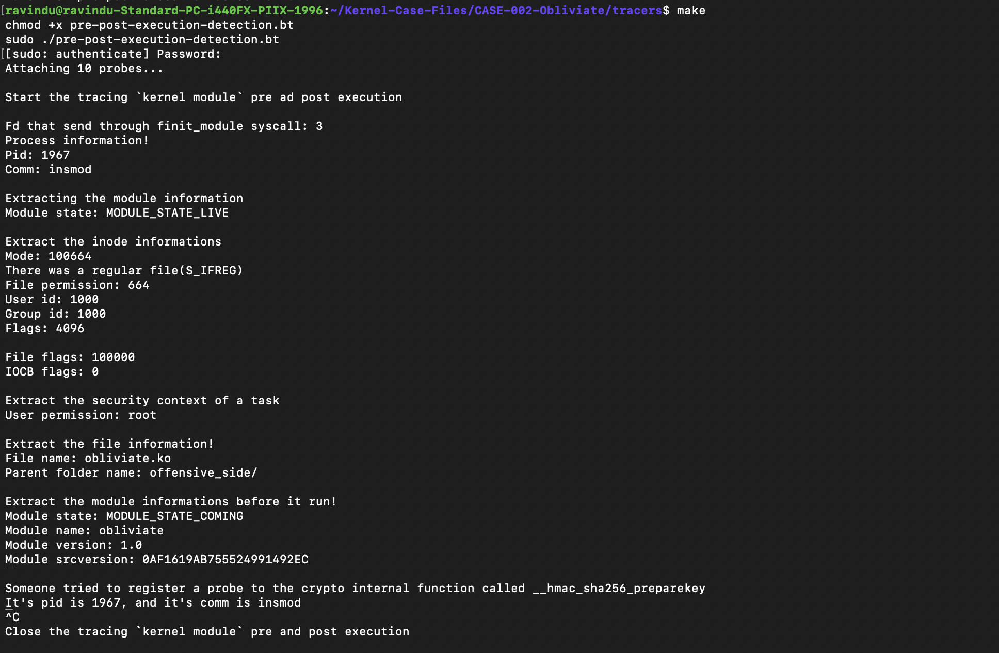

# Visibility Layers

- CLAIM
    - Tracing our offensive kernel module via a few different layers.

- TEST
    - run tracers/pre-post-execution-detection.bt

- RESULT
**Tracers Output**

- INTERPRETATION

| layer | Information |
|-------|-------------|
| finit_module syscall | module loading |
| init_module syscall | module loading |
| kernel_read_file | Data before module to memory allocate |
| security_kernel_load_data | init_module -> security_kernel_load_data |
| do_init_module | Stage that module before run |
| sys_enter_delete_module | Modules unloading |
| find_module | module data before unload it |
| kallsyms_lookup_name | function address finder |
|----------|-----------|

- STATUS
    - `[CONFIRM]`