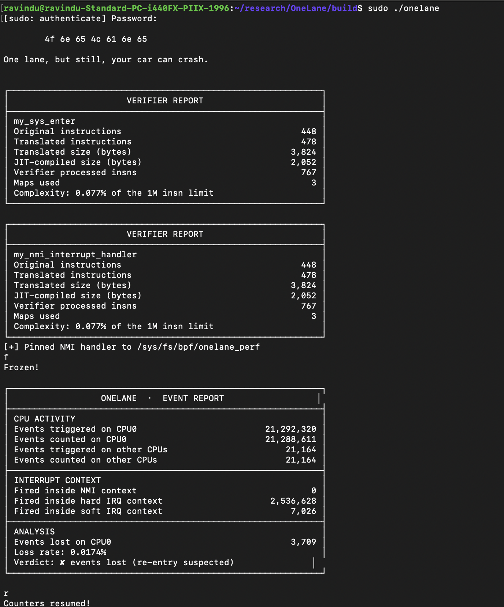

# OneLane
### Reverse-Engineering Lost Updates in eBPF Per-CPU Counters Under Interrupt Pressure

> One lane, but still, your car can crash.



**OneLane** is a Linux kernel investigation into a subtle problem with eBPF per-CPU counters: can an update be lost when execution is interrupted and another execution context modifies the same per-CPU value?

A per-CPU map avoids ordinary cross-CPU contention by maintaining separate values for each CPU. But what happens when two execution contexts on the **same CPU** access the same counter?

This project investigates that question by following the execution from eBPF source code to JIT-compiled x86-64 instructions and live kernel memory, then testing the hypothesis under interrupt pressure.

## The Investigation

The investigation follows several layers of the Linux kernel:

- **eBPF execution:** Comparing atomic and non-atomic counter updates.
- **JIT reverse engineering:** Inspecting translated BPF instructions and generated x86-64 assembly.
- **Kernel internals:** Investigating `BPF_MAP_TYPE_PERCPU_ARRAY`, `struct bpf_array`, and `percpu_array_map_lookup_elem()`.
- **Memory investigation:** Following `pptrs`, pointer arithmetic, and `this_cpu_off` using GDB.
- **Execution contexts:** Investigating process, hard-IRQ, soft-IRQ, and NMI context information.
- **Runtime experiments:** Generating interrupt pressure and comparing counter results.

## The Core Question

Consider a normal increment:

```c
*value += 1;
```

The JIT-generated x86-64 instructions perform three operations:

```asm
movq    (%rax), %rdi
addq    $1, %rdi
movq    %rdi, (%rax)
```

This is a read-modify-write sequence.

If another execution context updates the same counter between the original read and write, the original execution could overwrite the newer value.

The atomic alternative:

```c
__sync_fetch_and_add(value, 1);
```

Produces an atomic operation:

```asm
lock xaddq %rdi, (%rax)
```

OneLane investigates the difference experimentally rather than relying only on the assembly or documentation.

## Experimental Setup

Two eBPF execution paths were used:

| Execution path | Hook |
|---|---|
| Process context | `raw_tracepoint/sys_enter` |
| Interrupt context | `perf_event` |

The experiment included:

- `BPF_MAP_TYPE_PERCPU_ARRAY` for event counters.
- A second map used to expand the non-atomic update window.
- Atomic and non-atomic increment methods.
- A software CPU-clock perf event configured with `sample_period = 50`.
- CPU-specific event statistics.
- Execution-context inspection using `preempt_count`.

The non-atomic implementation deliberately expands the interval between reading and writing the counter to make the potential lost-update scenario easier to investigate.

## Experimental Results

Three experiments were performed.

| Experiment | CPU 0 events triggered | CPU 0 events counted | Lost events |
|---|---:|---:|---:|
| Non-atomic, without interrupt pressure | 5,094 | 5,094 | 0 |
| Non-atomic, with interrupt pressure | 21,292,320 | 21,288,611 | 3,709 |
| Atomic, with interrupt pressure | 32,074,330 | 32,074,330 | 0 |

### What happened?

**1. Without interrupt pressure**

The non-atomic counter completed without any reported lost events.

**2. With interrupt pressure**

The non-atomic counter reported 3,709 lost events on CPU 0.

**3. With interrupt pressure and atomic updates**

The atomic implementation reported no lost events, despite processing more events.

These results support the lost-update hypothesis under the tested conditions.

## Important Experimental Limitation

The original experiment was intended to investigate NMI-based re-entry.

However, the environment was a virtual machine without the required NMI behavior for this experiment. The trigger was changed to a software CPU-clock perf event.

The recorded results showed:

- NMI events: 0
- Hard-IRQ events: observed
- Soft-IRQ events: observed

Therefore, the experiment demonstrates counter mismatches under the tested interrupt-pressure conditions. It should not be interpreted as proof of an NMI-specific race or of the exact instruction-level interleaving responsible for every lost update.

## Key Findings

- A per-CPU map does not automatically make every read-modify-write sequence atomic.
- The non-atomic increment generates separate load, arithmetic, and store instructions.
- Atomic increments use a locked read-modify-write operation.
- Interrupt pressure coincided with counter loss in the non-atomic experiment.
- The atomic comparison reported no counter loss.
- Sharing writable state between execution contexts deserves careful investigation, even when using per-CPU storage.

## Further Investigation

Atomic operations are one way to protect shared updates, but they are not necessarily the only design option.

One alternative worth investigating is separating writable state between execution contexts and using a ring buffer when communication is required.

This could remove the shared-counter conflict instead of making every update atomic. That alternative remains a design direction, not an experimentally validated result of this case file.

## Why OneLane?

The objective wasn't simply to demonstrate that atomic operations work.

It was to understand what happens underneath the per-CPU abstraction:

**Source code → BPF instructions → x86-64 JIT → Kernel memory → Runtime behavior.**

Every layer provided another piece of evidence.

Sometimes the interesting bugs aren't hiding between CPUs. They're hiding in the execution paths sharing the same CPU.

---

*Part of Kernel-Case-Files — Linux kernel investigations through source code, assembly, memory inspection, and runtime experiments.*

---

## Writeup

- 